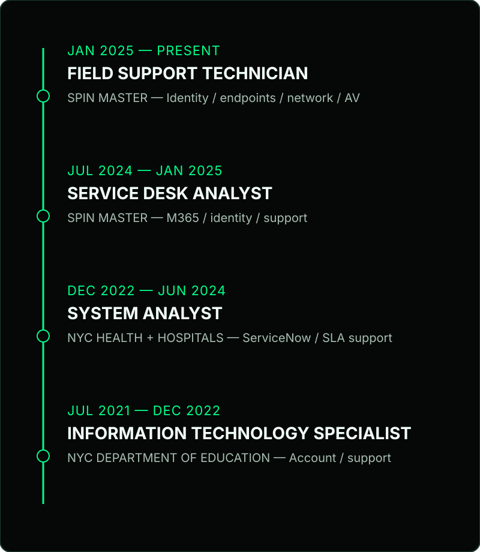

  

 

## ENGINEERING AT A GLANCE

  

## ENGINEERING CONTROL PLANE

  

Conceptual expertise model — not a depiction of a deployed production environment or live telemetry.

## IDENTITY & ACCESS

  

## ENDPOINT ENGINEERING

  

## NETWORK INFRASTRUCTURE

  

## CLOUD & MICROSOFT 365

  

## ENTERPRISE OPERATIONS

  

## COLLABORATION SYSTEMS

  

## TECHNICAL CAPABILITIES

  

## ENGINEERING EXPERIENCE

  

## ENGINEERING IN PRACTICE

  

## PROJECTS & TECHNICAL WORK

  

| Project | Implemented technology and scope |
|---|---|
| [Gym Management Web Application](https://github.com/Richardadel/Gym-Management-System-Project) | PHP, MySQL, sessions, authentication, memberships, trainers, classes, and enrollment relationships |
| [Yoga Studio Database](https://github.com/Richardadel/Yoga-Center-Project-) | MySQL and Microsoft Access design for members, instructors, classes, schedules, rooms, and memberships |
| [Cybersecurity Threat Analysis](https://github.com/Richardadel/MAT301) | CSV dataset covering 2015–2024 cybersecurity incidents with country, attack, target, financial, user, source, vulnerability, defense, and resolution fields |

## COMPUTER SCIENCE FOUNDATION

  

## LET'S CONNECT

  
  

