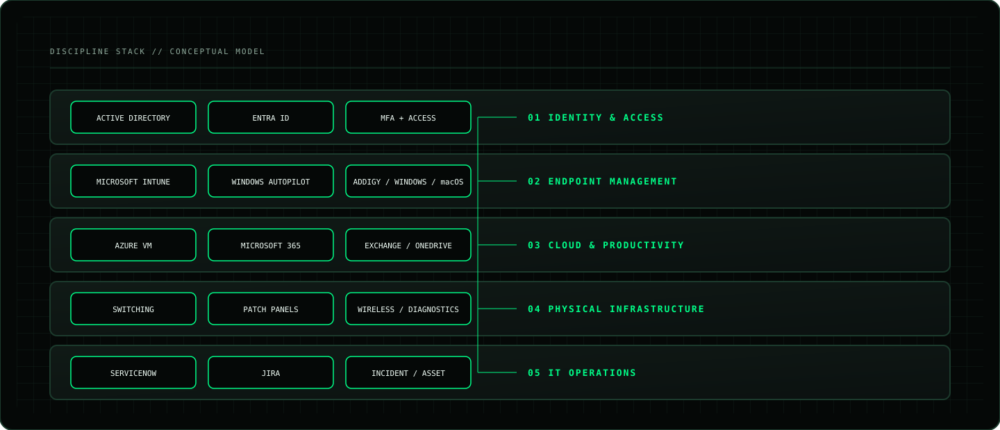
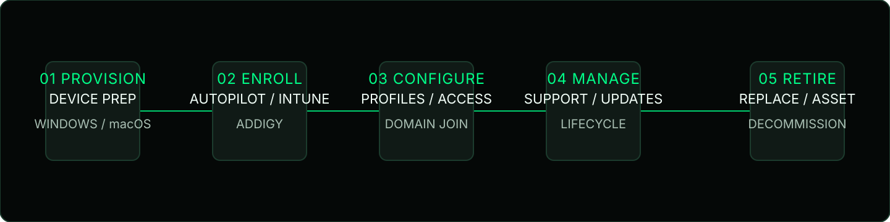
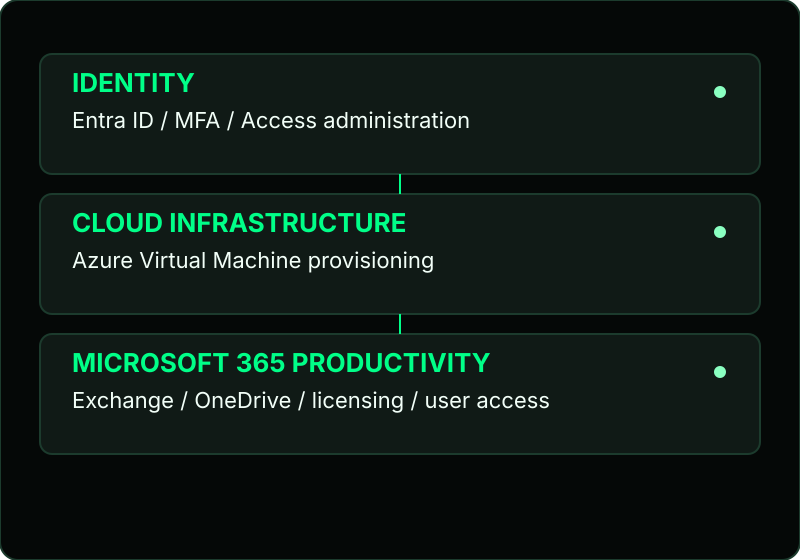

<div align="center">
  
</div>

<br>

## ENGINEERING AT A GLANCE

<div align="center">
  
</div>

## ENGINEERING CONTROL PLANE

<div align="center">
  
</div>

*A conceptual map of enterprise infrastructure disciplines — not a representation of live or production systems.*

## IDENTITY & ACCESS

### Enterprise identity administration and access operations

<div align="center">
  
</div>

Identity administration across Active Directory and Microsoft Entra ID.

## ENDPOINT LIFECYCLE

### Provisioning, enrollment, configuration, and device management

<div align="center">
  
</div>

## NETWORK INFRASTRUCTURE

### Physical connectivity, diagnostics, and infrastructure support

<div align="center">
  
</div>

Layer 1/2 infrastructure support, switch-port diagnostics, patch-panel cabling, and network troubleshooting.

## CLOUD & MICROSOFT 365

### Cloud administration, productivity services, and Azure experience

<div align="center">
  
</div>

Hands-on administration across Microsoft cloud and productivity services.

## IT OPERATIONS & INCIDENT MANAGEMENT

### Structured troubleshooting and enterprise service delivery

<div align="center">
  
</div>

## COLLABORATION SYSTEMS

### Meeting-room technology, enterprise AV, and real-time technical support

<div align="center">
  
</div>

## TECHNICAL CAPABILITIES

| Domain | Technologies |
|---|---|
| Identity | Active Directory, Entra ID, MFA, Security Groups |
| Endpoints | Intune, Autopilot, Addigy, Windows, macOS |
| Cloud | Azure VM, Microsoft 365, Exchange Online |
| Infrastructure | Layer 1/2 Diagnostics, Switches, Patch Panels |
| Operations | ServiceNow, Jira, ITAM, SOPs |
| Collaboration | Teams Rooms, Zoom, Poly, Crestron, Neat |

## ENGINEERING EXPERIENCE

### Field Support Technician — Spin Master
**January 2025 – Present**

Hybrid identity, endpoint management, network infrastructure support, and enterprise collaboration systems.

`AD DS` `Entra ID` `Intune` `Autopilot` `Addigy` `Microsoft 365`

### Service Desk Analyst — Spin Master
**July 2024 – January 2025**

Enterprise user lifecycle, Microsoft 365 administration, identity support, and technical troubleshooting.

### System Analyst — NYC Health + Hospitals
**December 2022 – June 2024**

Tier 2 application support, ServiceNow incident management, identity operations, and SLA-based troubleshooting.

### Information Technology Specialist — NYC Department of Education
**July 2021 – December 2022**

Enterprise technical support, account administration, troubleshooting, and technical guidance.

## ENGINEERING IN PRACTICE

<div align="center">
  
</div>

## PROJECTS & TECHNICAL WORK

<div align="center">
  
</div>

| Project | Technical scope | Repository |
|---|---|---|
| Gym Management Web Application | PHP, MySQL, authentication, memberships, classes, trainers | [Repository](https://github.com/Richardadel/Gym-Management-System-Project) |
| Yoga Studio Database | SQL, relational entities, ER modeling, MySQL, Microsoft Access | [Repository](https://github.com/Richardadel/Yoga-Center-Project-) |
| Cybersecurity Threat Analysis | Threat dataset, data exploration, statistics, visualization | [Repository](https://github.com/Richardadel/MAT301) |

## COMPUTER SCIENCE FOUNDATION

**Bachelor's Degree — Computer Science**  
Lehman College, City University of New York · January 2025

Programming Fundamentals · Linux Fundamentals · Python Fundamentals · SQL Fundamentals · HTML & CSS

## LET'S CONNECT

[](https://www.linkedin.com/in/richardfathalla)
[](https://github.com/Richardadel)

```text
> connection.ready
```
