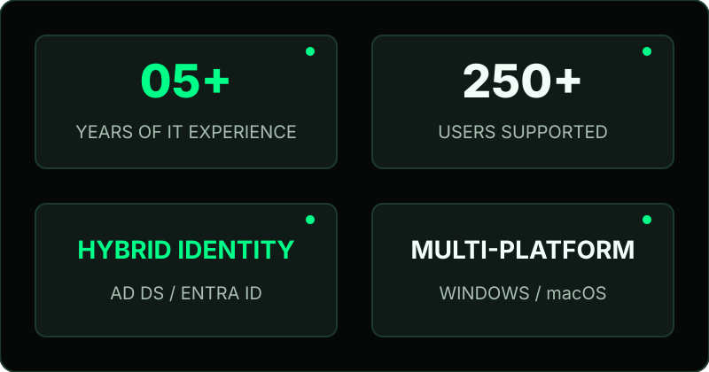
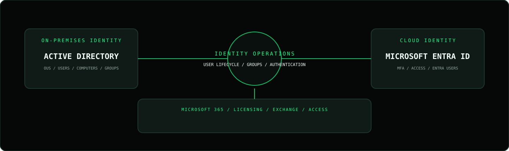
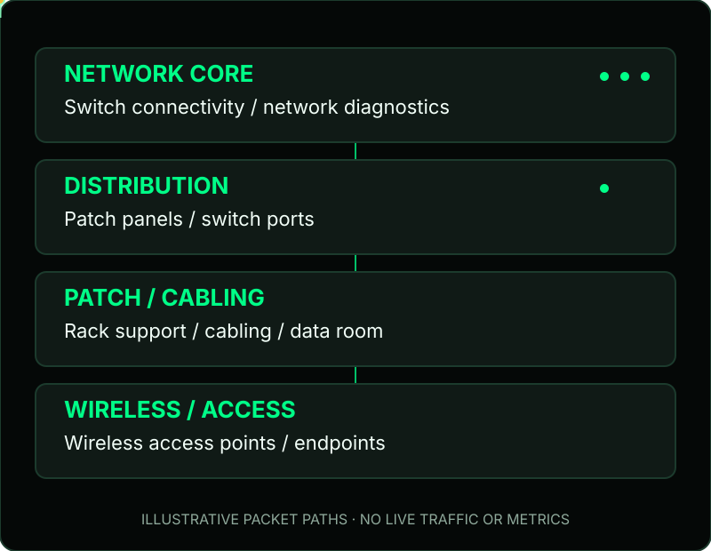
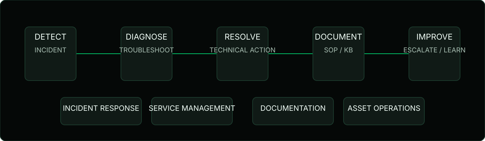
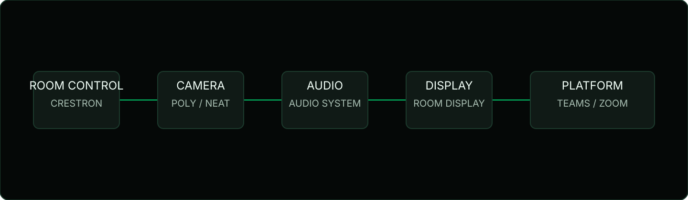
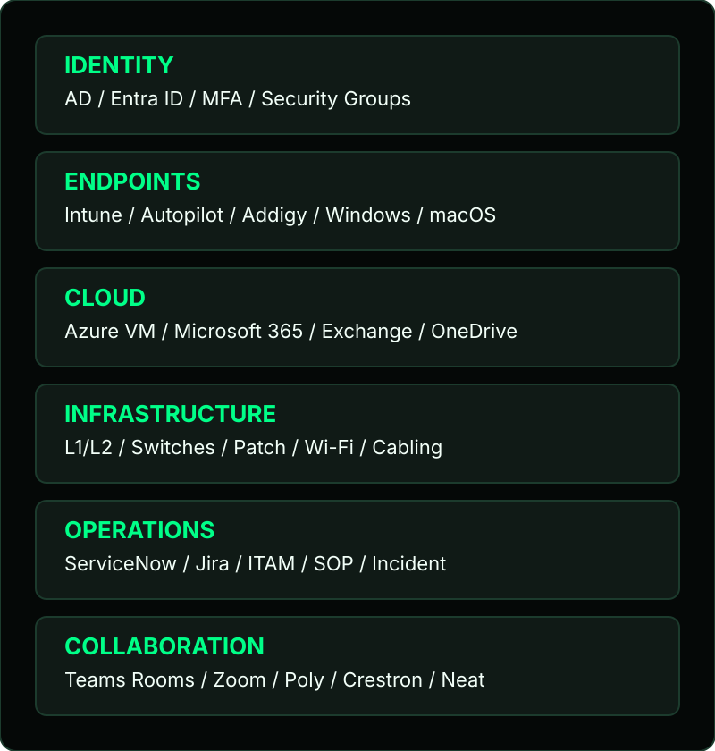
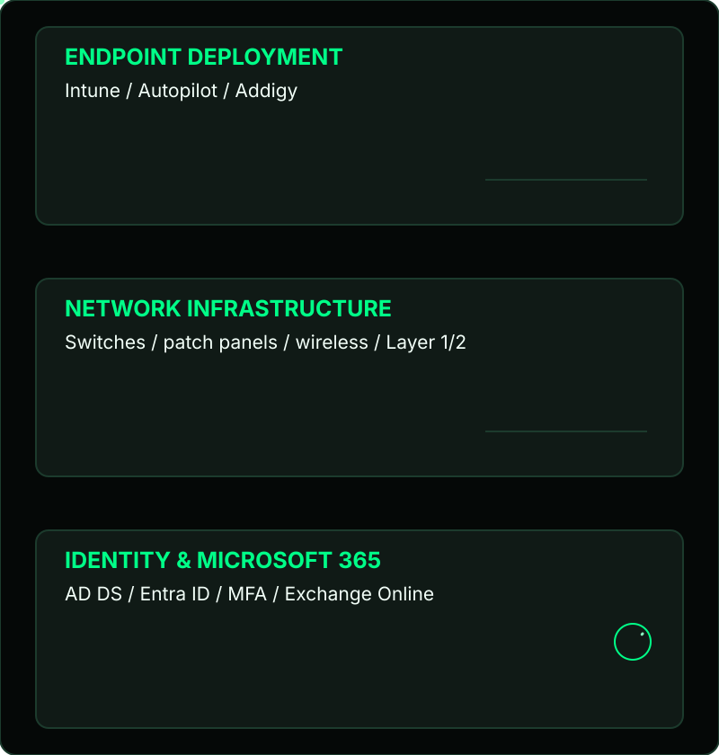
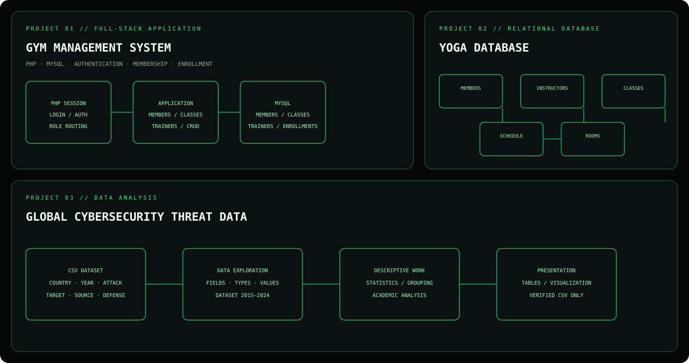
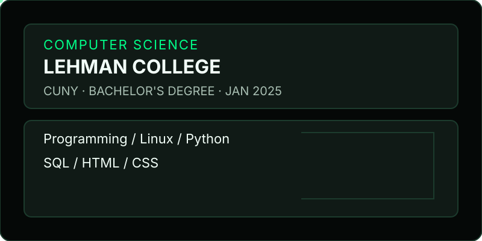

  

 

## Engineering Profile

IT infrastructure and systems support professional with 5+ years of enterprise experience across identity administration, endpoint management, networking, and technical operations. Hands-on experience with Active Directory, Microsoft Entra ID, Intune, Windows Autopilot, Addigy, Microsoft 365, and Azure VM provisioning.

## ENGINEERING AT A GLANCE

  

## ENGINEERING CONTROL PLANE

  

Conceptual expertise model — not a depiction of a deployed production environment or live telemetry.

## IDENTITY & ACCESS

Administered hybrid identity operations across Windows Server Active Directory Domain Services and Microsoft Entra ID, including user and computer objects, organizational units, security groups, access controls, and authentication support. Managed Microsoft 365 licensing, Exchange Online, MFA configuration, and access administration. Supported consistent onboarding, maintenance, and offboarding workflows.

  

## ENDPOINT ENGINEERING

Managed enterprise endpoint lifecycles across Windows 10/11 and macOS through Microsoft Intune, Windows Autopilot, and Addigy MDM. Provisioned devices, configured domain joining and enrollment, deployed configuration profiles, and coordinated hardware assignment, replacement, and retirement. Troubleshot endpoint software, operating system, enrollment, and configuration issues for onsite and remote users.

  

## NETWORK INFRASTRUCTURE

Provided on-site Layer 1/2 infrastructure support and network troubleshooting across enterprise environments, including switch-port diagnostics, patch-panel cabling, wireless access point work, and data-room operations. Assisted the network team during a site-wide upgrade with rack and server installation, cabling, and switch-port support. Applied structured diagnosis to restore connectivity and document unresolved infrastructure issues.

  

## CLOUD & MICROSOFT 365

Provisioned an Azure Virtual Machine through approved Azure Portal procedures. Administered Microsoft 365, Exchange Online, OneDrive access, Microsoft Entra ID, MFA, licensing, mailboxes, and user access workflows. Supported enterprise cloud services through controlled identity and access administration.

  

## ENTERPRISE OPERATIONS

Resolved incidents through structured ServiceNow and Jira workflows, including technical diagnosis, escalation, detailed ticket documentation, and SLA-based support. Supported onboarding and offboarding, IT asset operations, standard operating procedures, and knowledge-base documentation. Coordinated Tier 1/2 troubleshooting and communicated findings to users and technical teams.

  

## COLLABORATION SYSTEMS

Supported enterprise collaboration environments using Microsoft Teams Rooms, Zoom, Poly, Crestron, and Neat Devices. Conducted pre-meeting equipment checks, event support, and broadcast or webinar assistance. Troubleshot real-time audio and video issues to maintain reliable meeting-room operations.

  

## TECHNICAL CAPABILITIES

  

## ENGINEERING EXPERIENCE

  

## ENGINEERING IN PRACTICE

These case studies summarize verified professional experience rather than public projects or deployed production designs. They highlight applied identity, endpoint, and network knowledge across operational work. Proprietary scripts, configurations, and internal employer infrastructure remain excluded.

  

## PROJECTS & TECHNICAL WORK

Public projects include a database-driven PHP gym application, a MySQL and Microsoft Access yoga studio database, and a cybersecurity threat dataset for academic analysis. The gym application implements authentication, session handling, memberships, trainers, classes, and enrollment relationships. The yoga project models members, instructors, classes, schedules, rooms, and memberships. The data repository contains a 2015–2024 cybersecurity incident CSV prepared for exploration and statistical work.

  

| Project | Implemented technology and scope |
|---|---|
| [Gym Management Web Application](https://github.com/Richardadel/Gym-Management-System-Project) | PHP, MySQL, sessions, authentication, memberships, trainers, classes, and enrollment relationships |
| [Yoga Studio Database](https://github.com/Richardadel/Yoga-Center-Project-) | MySQL and Microsoft Access design for members, instructors, classes, schedules, rooms, and memberships |
| [Cybersecurity Threat Analysis](https://github.com/Richardadel/MAT301) | CSV dataset covering 2015–2024 cybersecurity incidents with country, attack, target, financial, user, source, vulnerability, defense, and resolution fields |

## COMPUTER SCIENCE FOUNDATION

  

## LET'S CONNECT

  
  

